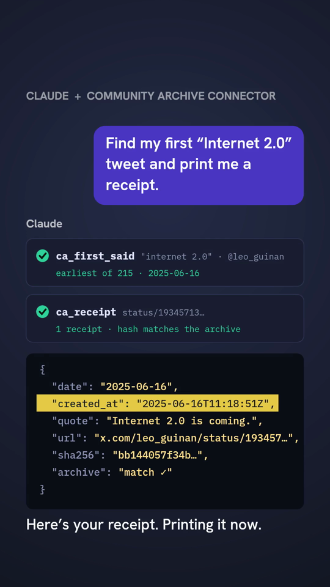
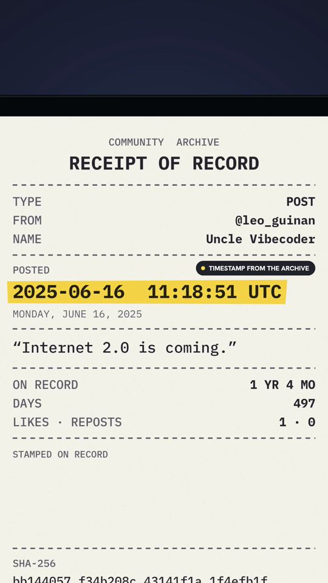
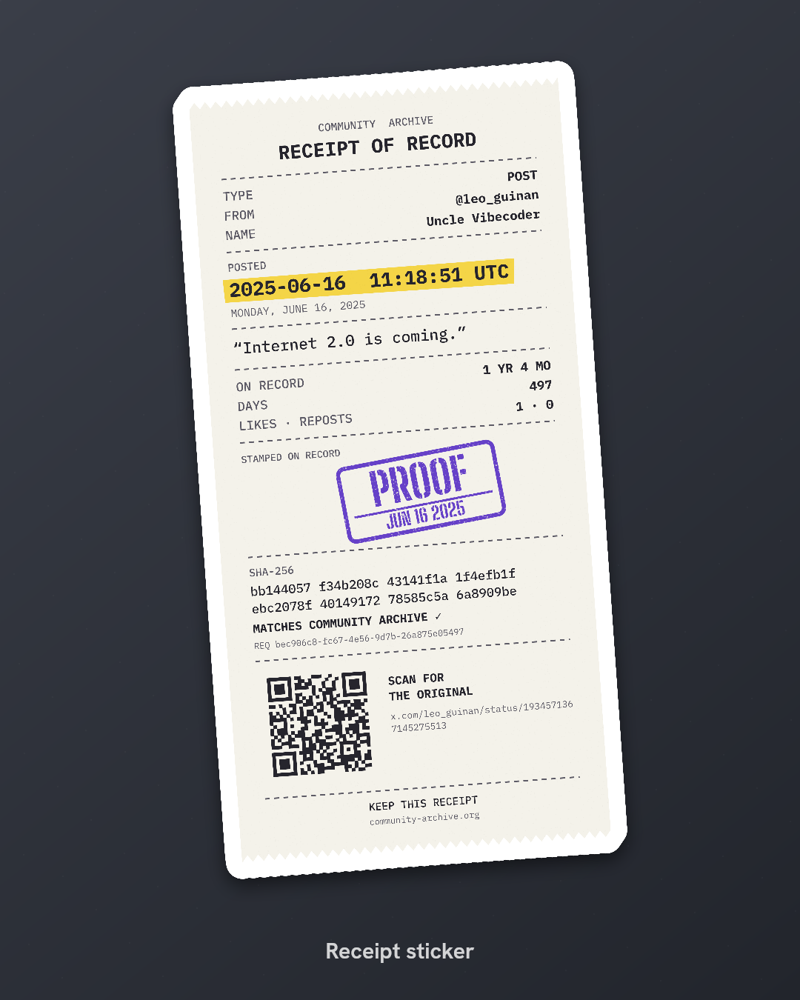

# Community Archive connector

An MCP server for the [Community Archive](https://www.community-archive.org), the open database of uploaded Twitter/X archives. It runs two ways from the same code:

- **Hosted connector** (Cloudflare Worker). People paste one URL into Claude, click **Connect**, and enter their own Community Archive API key on a sign-in page. Nothing to install.
- **Local server** (stdio). For people who'd rather run it on their own machine.

Both use the archive's keyed API v1 (`https://analytics.community-archive.org/v1`). The legacy Supabase REST API is retired on 2026-11-19 and isn't used.

## Try it

A hosted instance is running at:

```
https://community-archive-mcp.leo-guinan.workers.dev/mcp
```

In Claude, go to **Customize → Connectors → Add custom connector**, paste that URL, click **Connect**, and enter your key from [community-archive.org/settings/api-keys](https://www.community-archive.org/settings/api-keys). Then ask something like *"Find my first tweet about build in public and give me a receipt."*

This is an independent project, not an official Community Archive service. The plan is to hand it to the Community Archive maintainers ([HANDOFF.md](HANDOFF.md)).

<p>
  
  
  
</p>

Receipts become videos and stickers with the [receipt-video example](examples/receipt-video).

## Tools

All tools are read-only.

**API v1**

| Tool | Route | Notes |
| --- | --- | --- |
| `ca_me` | `GET /me` | The key and its limits. |
| `ca_get_tweets` | `GET /tweets/{id}`, `GET /tweets?ids=` | 1–100 IDs **or status URLs**; reports which are missing. |
| `ca_search_tweets` | `GET /tweets/search` | Full text, `from_user`, `reply_to_user`, `since`/`until`, offset paging. |
| `ca_account` | `GET /accounts/{account}`, `GET /accounts?usernames=\|ids=` | Accepts `@handle` and profile URLs. |
| `ca_account_tweets` | `GET /accounts/{account}/tweets` | Order, date range, skip replies/retweets, several pages per call. |
| `ca_tweets_window` | `GET /tweets?since=&until=` | Everything in a window of up to 31 days. |
| `ca_account_relations` | `GET /accounts/{account}/likes\|followers\|following` | Archive-derived edges. |
| `ca_members` | `GET /members` | Current members. |

Tweets come back **compact** by default (id, permalink, user, date, text with t.co links expanded, counts, reply and quote pointers). Pass `format: "full"` for every API field.

**Built on top**

| Tool | What it does |
| --- | --- |
| `ca_receipt` | Dated proof record of up to 25 tweets: exact text, timestamp, permalink, author, a SHA-256 over `kind\|date\|url\|quote`, and the API `request_id` as provenance. |
| `ca_thread` | The reply chain above a tweet plus the author's own continuation below it. Notes parents that aren't in the archive. |
| `ca_first_said` | Earliest archived uses of a phrase, overall or by one person. Says when the scan was incomplete. |
| `ca_phrase_timeline` | Counts per day, week, month or year, with first and latest use and top authors. Covers what the retired `word_occurrences` RPC did. |
| `ca_who_talks_about` | People ranked by how often they tweet about a topic, with first mention and best-received tweet. |
| `ca_find_people` | People by partial name or handle: fuzzy, accent-insensitive, over the member list (v1 has no account search). |
| `ca_relation_overlap` | Shared followers or following between two accounts, with Jaccard similarity. |

## Using the hosted connector

In Claude: **Customize → Connectors → Add custom connector**, paste `https://<host>/mcp`, then **Connect**. A page asks for your key ([create one here](https://www.community-archive.org/settings/api-keys)). On Team and Enterprise plans an Owner adds the connector first, under **Organization settings → Connectors**, and each member then connects with their own key.

Claude Code:

```bash
claude mcp add --transport http community-archive https://<host>/mcp
```

Clients that can't do OAuth can send the key directly: `Authorization: Bearer cak_...`. See [How sign-in works](#how-sign-in-works) for the trade-off.

## Running locally (stdio)

```bash
npm install && npm run build
CA_API_KEY=cak_... node dist/stdio.js
```

Or point `CA_ENV_FILE` at a dotenv file containing `CA_API_KEY` or `COMMUNITY_ARCHIVE_API_KEY`, which keeps the key out of client config. Claude desktop:

```json
"community-archive": {
  "command": "node",
  "args": ["/ABSOLUTE/PATH/dist/stdio.js"],
  "env": { "CA_ENV_FILE": "~/.config/community-archive/.env" }
}
```

## How sign-in works

The hosted connector is its own OAuth 2.1 authorization server, built on [`@cloudflare/workers-oauth-provider`](https://github.com/cloudflare/workers-oauth-provider):

1. Claude's request to `/mcp` gets a `401` pointing at the server's metadata.
2. Claude registers itself, either with a Client ID Metadata Document ("Use Claude's published identity") or Dynamic Client Registration ("Register automatically"). Both are supported.
3. The user lands on `/authorize`, which shows the app asking, where access will be sent, and a field for their key.
4. The server checks the key with `GET /v1/me`. A wrong or malformed key brings the page back with an error.
5. The key is stored only inside the grant's `props`, which the library encrypts with a key that only that grant's tokens can unwrap. Tokens are stored only as hashes. Claude receives its own access and refresh tokens, never the archive key.
6. Each MCP request decrypts the key and calls the archive with it.

**Direct keys.** With `ALLOW_DIRECT_KEYS` on, `/mcp` also accepts `Authorization: Bearer cak_...`. The key is checked against `/v1/me` (remembered for five minutes by a hash) and used for that request only. This is token passthrough, which the MCP authorization spec discourages; it exists for scripts and clients without OAuth. Set `ALLOW_DIRECT_KEYS` to `"false"` to turn it off.

**Limits.** Every call counts against the user's own key (60 a minute, 20,000 a day). The hosted server retries `429`/`503` briefly, then reports the limit to the assistant rather than waiting. Archive responses are public and identical across keys, so isolates share a short in-memory cache.

## Examples

[`examples/receipt-video`](examples/receipt-video) turns `ca_receipt` output into a printed-receipt MP4, with the timestamp highlighted and a QR code that opens the original post, and into a die-cut sticker PNG. It also renders a demo video of the whole flow.

## Development

```bash
npm test          # unit tests: every tool against an in-memory fake of API v1
npm run test:e2e  # runs the Worker locally and walks the whole connect flow (17 checks)
npm run typecheck # both the Node and the Worker builds
```

The end-to-end test starts `wrangler dev --env test` against a mock archive on port 8798 and checks discovery, registration, the key page, wrong and malformed keys, PKCE token exchange, MCP calls, refresh, direct keys, cancel, forged forms, unregistered redirects, and that the plaintext key never appears in KV storage or logs.

Deploying: [DEPLOY.md](DEPLOY.md). Privacy policy: [PRIVACY.md](PRIVACY.md). Handing the project to the Community Archive team: [HANDOFF.md](HANDOFF.md).

## License

MIT
